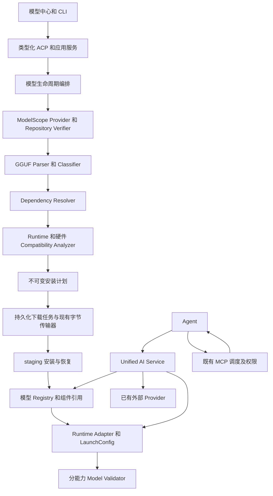

# lumina 模型生命周期完整升级计划

本计划覆盖从 ModelScope 搜索、GGUF 解析、依赖匹配、下载、安装、注册，到多类 Runtime、真实能力验收、模型中心、Agent 和 MCP 整合的全部建设工作。工程基线为 `testing` 分支提交 `fa7bb0a4d38a22f9e2cc26f307b304965f88a74c`，源码版本 `1.43.0-mcp.14`。后续实施以基线之后经审查合入的源码增量推进。

目标是让用户完成“搜索模型 → 选择量化和用途 → 查看兼容性及完整组件 → 安装 → 自动启动 → 真实验收 → 使用”。每个成功状态必须具有对应证据。计划覆盖全部目标，不把后续模型类型留作无任务、无接口、无验收标准的笼统扩展。

本计划的完成代表规划交付完成，不代表功能已开发或模型已通过运行验证。2026 年 11 月 1 日的基线审查为静态源码审查；本文涉及的 Runtime 候选与远程模型都需要执行计划中的实测门槛。原始任务附件在“视觉模型”处结束；本计划覆盖附件中已给出的全部要求。

配套文档：

- [架构和接口契约](./model-lifecycle-contracts.zh-CN.md)：数据、状态、ACP、安装恢复、Runtime 和界面契约。
- [完整工作包](./model-lifecycle-work-packages.zh-CN.md)：48 个工作包、依赖、文件落点、责任角色和交付物。
- [验收和需求追踪](./model-lifecycle-acceptance.zh-CN.md)：逐类真实验收、异常场景、需求映射和发布门槛。

## 产品边界和强制决策

1. 所有受管模型的搜索、详情、文件清单、元数据和权重下载只使用 ModelScope；禁止自动切换模型平台，禁止按名称制造仓库或文件记录。
2. 权重只接受 GGUF。单文件、多分片和多组件均纳入；Safetensors、ONNX、PyTorch 以及用其他扩展名伪装的非 GGUF 权重不得进入安装计划。
3. 运行所需 tokenizer、模板、调度配置等元数据按具体文件用途白名单接受；不得通过任意 JSON、压缩包或脚本绕过权重限制。
4. 已有云端和外部推理 Provider 继续保留。远程推理属于服务连接，不冒充 ModelScope 受管本地安装，也不能成为本地模型下载的隐式备用来源。
5. 模型管理与 Agent 解耦。模型生成工具调用，Agent 管理循环和权限，MCP 执行工具；模型中心不能绕过既有 MCP 平台治理。
6. 组件完整性、硬件适配、安装完成、进程运行和能力可用分别记录。文本可用不代表视觉、音频或工具调用可用。
7. 保留已有成熟实现，通过业务接口逐步接入。旧数据迁移、来源追踪、恢复和回归测试是主线任务。
8. 没有可用的 ModelScope 全 GGUF 组件或可验证 Runtime 时，该组合保持阻塞。明确阻塞是正确产品行为，但不等于该目标能力已经实现。

## 当前源码基线

| 范围 | 现有实现和调用位置 | 静态审查结论 |
| --- | --- | --- |
| Workspace 和发行版本 | 根 `Cargo.toml`、`ui/desktop/package.json` | 版本为 `1.43.0-mcp.14`；Rust 最低版本字段为 `1.94.1` |
| 应用启动 | `crates/lumina-cli/src/main.rs`、`ui/desktop/src/main.ts`、`ui/desktop/src/luminaServe.ts` | 桌面主进程启动或连接 lumina serve；渲染端通过 ACP 访问业务 |
| 搜索与文件解析 | `crates/lumina-local-inference/src/hf_models.rs` | 主搜索及 GGUF 下载路径使用 ModelScope；Revision 固定为 master；目录及量化名参与识别 |
| 管理服务 | `crates/lumina-local-inference/src/management.rs` | 处理列表、待下载登记、异步解析下载、取消和设置；推荐项解析失败存在合成文件记录 |
| 下载 | `crates/lumina-download-manager/src/lib.rs` | 有 Range 并行、断点、重试、文件锁、速度、ETA、可选 SHA256；已有目标文件跳过校验；任务主体在内存 |
| 注册 | `crates/lumina-local-inference/src/local_model_registry.rs` | registry.json 有加锁和临时文件保存；下载状态主要依据文件存在；缺少安装版本和完整依赖证据 |
| 推理 | `crates/lumina-local-inference/src/lib.rs`、`backend.rs`、`llamacpp/` | 已有 Runtime 和后端 trait；llama.cpp 经 Rust 库进程内调用；包含 mtmd 和工具调用实现 |
| 硬件 | `llamacpp/mod.rs`、`llamacpp/inference_engine.rs` | 有 GPU 层估算、CPU 回退和基于模型参数的 Context 估算；尚未形成完整安装前分析 |
| 历史格式入口 | `hf_models.rs`、`management.rs`、`mlx.rs` | 后端仍接受 mlx 选择并保留 HF/Safetensors 下载路径，需统一封闭新安装入口 |
| 本地 ASR | `crates/lumina/src/dictation/whisper.rs`、`acp/server/dictation.rs` | 已有 Candle GGUF 听写实现；模型地址仍指向 HF，需要迁移来源和生命周期 |
| 桌面模型页 | `ui/desktop/src/components/settings/localInference/` | React 本地状态与轮询；下载完成后自动选择；未形成统一安装与能力状态 |
| 协议 | `crates/lumina-sdk-types/src/custom_requests.rs`、`ui/sdk/` | 已有 ACP 自定义请求和 SDK；旧方法含 huggingface 历史名称 |
| Agent 和 MCP | `crates/lumina/src/agents/agent.rs`、`extension_manager.rs`、`mcp_client.rs` | Provider 生成、工具调度、执行结果回传链路存在；运行效果本轮未验证 |
| 外部推理 | `crates/lumina-providers/src/openai_compatible.rs`、`ollama.rs` 等 | 可复用 Provider 边界；不等同于新的本地模型生命周期服务 |
| 验证与品牌 | `crates/lumina/tests/local_inference_integration.rs`、`lumina-self-test.yaml`、`COMMERCIAL_RELEASE.md` | 有被 ignore 的真实推理测试和部分视觉流程；保留独立品牌、构建来源和发行治理 |

以上“存在实现”不作运行通过声明。未找到的通用解析器、完整依赖图、持久化安装协议和类型化 Validator 为本计划的建设项。

## 当前流程和目标架构

当前搜索：桌面搜索组件 → `acp/local-inference.ts` → SDK 自定义请求 → `acp/server/local_inference.rs` → `management` → `hf_models` → ModelScope。仓库文件在展开结果时获取，不能把尚未核验的搜索条目当成已有 GGUF 或兼容模型。

当前下载：管理服务创建待下载记录 → 后台解析仓库 → 主文件和可选 mmproj 交给下载器 → 下载完成 → GGUF 初步检查 → 注册模型。传输完成与后续校验、登记之间存在时间窗口。

当前使用：页面保存默认模型 → Agent 请求 Provider → `LocalInferenceProvider::stream` 解析注册表 → `InferenceRuntime` 选择后端和缓存槽 → llama.cpp 加载并生成 → Agent 处理工具请求 → MCP 执行 → 结果回到会话。

目标职责如下，生命周期模块首先落在现有 `lumina-local-inference` 内，避免先做大规模 crate 拆分。

## 全部模型和组件推进矩阵

每个类别都要交付“发现与分类、完整依赖、Runtime 适配、类型化服务、真实验收、UI、Agent 使用路径”。下表没有未分配到工作包的类别。

| 目标 | Runtime 路线 | 组件重点 | 工作包和完成门槛 |
| --- | --- | --- | --- |
| Dense LLM | 包装现有 llama.cpp 绑定 | 主 GGUF、分片、模板 | ML-11 至 ML-26；文本、多轮、工具分别验收 |
| MoE LLM | 同一 Adapter 的架构专用能力声明 | 总参数与激活参数分开，实际内存规则 | ML-12、ML-15、ML-25、ML-26；不能按激活参数估算全部权重内存 |
| VLM | 现有 llama.cpp 和 mtmd | 主模型、mmproj、图像预处理配置 | ML-13、ML-14、ML-25、ML-26；图像理解与视觉多轮实测 |
| Embedding | 验证绑定的 embedding 路径；不足时评估固定版本 helper | pooling、维度、归一化、输入限制 | ML-27；向量有效性和语义检索验收 |
| Reranker | 验证 rank scoring 接口，禁止复用聊天输出冒充打分 | query/document 模板、pooling、分数语义 | ML-28；真实排序和重复性验收 |
| ASR | 优先适配已有 Candle Whisper GGUF | 音频预处理、tokenizer、mel 配置 | ML-29；来源迁移和真实转写验收 |
| TTS | ML-03 对可消费 GGUF 的候选引擎逐项验证并锁定版本 | 文本前端、声学模型、vocoder 或 codec 的所有权重 | ML-30；不存在全 GGUF 组合则阻塞，完成需真实音频生成 |
| 通用 Audio | 按实际模型任务选择 Adapter | audio encoder、decoder、codec、采样率 | ML-33；理解和生成分别注册能力 |
| Image Diffusion | stable-diffusion.cpp 作为待验证候选，不作为已支持承诺 | diffusion、VAE、text encoder、可选控制组件 | ML-31；全部必要权重 GGUF，真实图像输出 |
| Video Diffusion | 评估固定版本 diffusion Runtime 的具体架构 | 时序模型、VAE、text/image encoder、编码输出 | ML-32；真实帧生成、编码、解码及播放验收 |
| MTP | 按具体架构核验绑定和引擎；不能与普通 draft 等同 | 内置或独立 MTP 组件、tokenizer 关系 | ML-34；质量、性能及回退实测 |
| DFlash | 单独核验对应算法和引擎接口 | 配套 draft、训练关系、tokenizer、配置 | ML-35；禁止用任意小模型替代，独立验收 |
| 其他专用 GGUF | 受控 Adapter 和组件角色扩展协议 | 未知架构保留 UNKNOWN | ML-36；新增一种任务也必须有 Validator |

候选引擎支持 GGUF 不等于整套流水线只需要 GGUF。ML-03 必须尽早完成所有类型的可行性验证，而不是到末期才发现 VAE、vocoder 等必需组件无合规来源。需要新增或修改上游格式能力时，为对应工作包建立有边界的引擎开发子任务、投入估算和真实验证；不得以模型格式转换下载非 GGUF 权重来绕过决策。

## 里程碑和依赖

所有工作包初始状态为 `PLANNED`。实现顺序由依赖决定，扩展类型的来源和引擎验证从 M0 开始；UI 契约在 M0 确认，不等后端全部完成才设计。

| 里程碑 | 范围 | 前置条件 | 用户可见交付和出口 |
| --- | --- | --- | --- |
| M0 全量契约和技术验证 | ML-01 至 ML-07，所有类别的 ML-03、ML-04 | 当前源码基线 | 全类别支持台账、真实候选、结构和状态契约、实现风险与投入重估 |
| M1 来源解析和完整依赖 | ML-08 至 ML-15，ML-16 | M0 的契约稳定 | 可解释搜索、版本固定、GGUF 元数据、组件图、安装阻塞原因 |
| M2 可靠安装和数据迁移 | ML-17 至 ML-22 | M1、SQLite 与状态基础 | 多文件下载恢复、原子发布目录、模型注册、组件复用、卸载、旧数据迁移 |
| M3 Runtime 和核心真实验收 | ML-23 至 ML-26、ML-37、ML-40 | M1 的元数据和计划，M2 的安装 | LLM、MoE、VLM 分能力运行，Agent 聊天与工具调用 |
| M4 全部任务类型和加速 | ML-27 至 ML-36、ML-38、ML-39 | M0 可行性门槛、M2、M3 通用 Runtime 协议 | Embedding、Reranker、ASR、TTS、Audio、图像、视频、MTP、DFlash 完整闭环 |
| M5 完整模型中心 | ML-41 至 ML-44 | ML-40；按 M1 至 M4 已接入服务逐步交付 | 搜索、详情、依赖、任务、安装、运行、验证、日志、版本和卸载 |
| M6 系统验收和发行 | ML-45 至 ML-48 | 所有声明支持的 M1 至 M5 交付 | 故障恢复、硬件矩阵、安装包、回归、性能记录和可追溯发布 |

M3 可形成阶段版本，但整个升级目标只有 M4、M5、M6 也完成才可关闭。若任一要求类别仅为 BLOCKED，允许阶段发行如实列明范围，不允许称全部架构目标完成。

## 投入和排期

估算假设为一名生命周期后端、一名 Runtime 开发、一名前端、一名集成开发和一名验证人员；这些是责任角色，不代表本计划已分配人员或自动启动并行开发。先按核心和所有扩展可取得必要来源、无需大规模上游引擎开发估算。

| 投入范围 | 预计工程人日 | 建议窗口 |
| --- | --- | --- |
| M0 和所有类别技术验证 | 20 至 35 | 第 1 至 3 周 |
| M1 和 M2 | 55 至 85 | 第 3 至 9 周 |
| M3 和 Unified AI Service 基础 | 30 至 50 | 第 7 至 12 周 |
| M4 全类别适配与加速 | 80 至 140 | 第 9 至 24 周 |
| M5 模型中心完整交付 | 35 至 55 | 第 4 至 22 周 |
| M6 跨类别硬件验收和发行 | 35 至 55 | 第 20 至 28 周 |
| 总投入 | 255 至 420 | 有效并行后约 24 至 36 周，含集成缓冲 |

窗口可重叠，工程人日是所有角色合计，日历周期不能按人数直接相除。只有两名开发时全量范围需重新排期，不能沿用此前核心 LLM/VLM 闭环的 8 至 12 周估算。M0 若发现需开发引擎、补齐 GGUF 组件或没有可访问的 ModelScope 来源，必须更新对应工作包和关键路径；无法给外部能力补齐预先承诺固定日期。

## 风险处理和完成定义

| 风险 | 尽早验证点 | 处理和解除条件 |
| --- | --- | --- |
| 某类别没有全 GGUF 依赖链 | ML-03、ML-04 | 标记具体缺失组件；寻找真实 ModelScope 候选；需要引擎工作则单列，验证前不开放安装 |
| ModelScope 版本接口或访问行为不同于预期 | ML-08、ML-09 | 依据真实响应建立适配；无法取得不可变版本与足够证明时不发布可执行计划 |
| 上游能力与当前绑定不一致 | ML-23 至 ML-35 | 实测打包构建；必要时升级绑定或隔离 helper，并执行既有能力回归 |
| 旧数据误认完整安装 | ML-22 | 默认保留文件和设置，导入后重新确认来源、结构和能力；禁止静默标 READY |
| 多模型竞争显存和上下文 | ML-15、ML-24、ML-38 | 资源调度、预算、排队、显式降级及实际配置回报 |
| 文件与数据库提交中断 | ML-19、ML-21 | 日志驱动恢复，故障注入覆盖每个提交边界 |
| 任意模型组合不可自动推断 | ML-13、ML-14 | 证据规则和支持档案；相似度只生成候选，不自动认定兼容 |
| 版本升级破坏已有使用 | ML-46 至 ML-48 | 数据备份、只增不破坏迁移、安装和运行版本回退、现有功能回归 |

项目关闭要求：48 个工作包完成或其不适用部分具有满足原始目标的明确替代实现；全部硬性需求有实现和通过证据；所有要求模型类别至少有一个符合来源与格式约束的真实代表组合通过完整闭环；未验证项目不能计入通过；既有 MCP、云端 Provider、会话、模型配置和听写回归通过；安装包能够对应源码、Runtime 构建和验收记录。

来源与格式限制导致的客观阻塞必须保留在台账，不能通过把整个类别改成“其他专用模型”或把阻塞状态改成已完成消除。

## 参考依据

工程事实以本地基线源码为准。下列上游资料只用于协议和技术验证方向，不代替当前构建的实测结果。

- [GGUF 格式规范](https://github.com/ggml-org/ggml/blob/master/docs/gguf.md)：元数据与 Tensor 结构。
- [ModelScope 官方 Hub](https://github.com/modelscope/modelscope_hub)：来源访问与版本下载适配参考。
- [llama.cpp 多模态说明](https://github.com/ggml-org/llama.cpp/blob/master/docs/multimodal.md)：mtmd 和 projector 的上游边界。
- [stable-diffusion.cpp](https://github.com/leejet/stable-diffusion.cpp)：图像与视频 Runtime 的待验证候选；不证明所有必要组件均为 GGUF。
- [现有 MCP 架构](./mcp-platform-architecture.md)、[企业产品蓝图](./enterprise-product-blueprint.zh-CN.md)、[商业发行约束](../../../COMMERCIAL_RELEASE.md)：保持现有业务、中文交互和发行边界。
